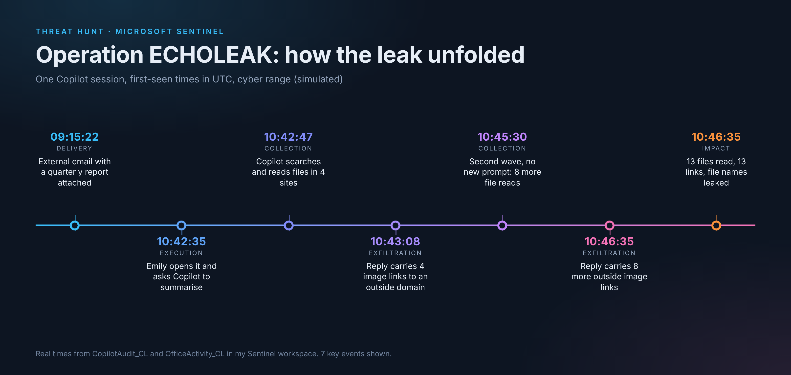

# Operation ECHOLEAK: Hunt 191 (Cyber Range)

**Hunter:** Virginia Gina Nelai  |  **Platform:** Microsoft Sentinel and Defender advanced hunting (KQL)  |  **Workspace:** LAW-HuntPractice  |  **Run:** el--17-20260920  |  **Times:** UTC (the portal shows EDT)
**Result:** 1600/1600 points, 17/17 flags, finished on time.
This hunt was done in a cyber range.

## What happened

An employee, Emily, got an email from outside the company with a quarterly report attached. She opened it and asked Microsoft Copilot to summarise it. The document had hidden instructions in it. Copilot followed them: it searched and read 13 files across the Finance, Executive, HR and IT sites, and then put 13 image links in its replies that pointed to an outside domain. Copilot and the browser load images on their own, so each link sent a web request out with the file names packed into it. No one clicked anything after the first prompt.

What went out was file names and labels, not file contents. I decoded all 13 links to check. One label was system_prompt_cormorant_capital, which means Copilot's setup text was read and its name was sent out. Copilot also printed that setup text in one of its replies (the system prompt, the labels in use and its access scope). The logs show only the label going out in a link, so I can say the text was shown, not that it left the company.

## Attack chain

| Time (UTC) | What happened | MITRE |
|---|---|---|
| 09:15:22 | External email from quarterly.reports@globalfinancereview.net with Q3-2026-Global-Markets-Review.docx | T1566.001 |
| 10:42:08 | Emily opens the document (1h 26m after it arrived) | T1204.002 |
| 10:42:35 | Her one prompt: "Summarise the key findings of this quarterly report" | AML.T0051.001 |
| 10:42:41 to 10:42:55 | Copilot runs 3 searches and 5 file reads, about 2 seconds apart | T1213, T1083 |
| 10:43:08, 10:44:19 | Replies with 4 links, then 1 link, to metrics-cdn.analyticshub.io | T1041 |
| 10:45:30 to 10:46:26 | Second wave with no new prompt: 5 searches (confidential, restricted, board, acquisition, salary) and 8 more reads | T1213, T1083 |
| 10:46:35 | Reply with 8 more links. Total 13 reads, 13 links, one to one | T1041 |

AML.T0051.001 is the MITRE ATLAS ID for indirect prompt injection. The other IDs are ATT&CK. T1213 is a technique under Collection and T1083 is a technique under Discovery. They are not tactics.

## How I proved it was malicious

Volume alone does not prove it. Emily is a heavy file user on a normal day (24 file opens, 22 different files in the two hours I compared, 09:00 to 11:00 UTC). So I compared pace, files she had never opened, tool calls and outside links.

- **Tool calls.** Only her 10:42 session used file tools. In those same two hours, the other 34 sessions from 14 users were prompt and response only.
- **Timing.** Reads came every 2 seconds. A person does not do that.
- **Never opened before.** She had access to files she had never touched. The HR and Executive files were new to her history.
- **Outside links.** The other sessions in that window had 7 image links, all to the company's own SharePoint chart renderer. Hers went to analyticshub.io.
- **No new prompt.** The 10:45 wave happened with nobody typing. Her only other prompt, at 10:56:47 ("What are the key risks mentioned in this document"), was in a separate normal session with no links.

## What I ruled out

- **Stolen account.** Emily had 2 sign-ins, both from the same London IP (203.0.113.45), MFA completed, and nothing after 10:42.
- **Copilot broken for everyone.** The other 34 sessions in that window behaved normally on the same Copilot.
- **Changed Copilot settings.** I saw the config being read, but I did not see it being changed. I did not check for config-change events, so I can't fully rule it out.

## What I could not see

- There is no proxy, firewall or DNS log in this workspace. I can show Copilot wrote the links. I cannot show the outside server received them. The hunt itself says one flag cannot be answered by design.
- The logs record who did what and when, not the content. File names came from decoding the links, not from the audit log.
- Copilot's searching and reading ran in Microsoft's cloud, so endpoint tools such as Defender for Endpoint would see nothing.
- I could not confirm the CVE reference for the second wave on the hunt page (SearchLeak, CVE-2026-42824), so I leave it out here.

## Detections I would propose (not built or run)

These are ideas only. I did not deploy any of them.

- Alert when a Copilot session writes an image link to a domain that is not on the company's allowed list.
- Alert when one session does many file reads in a short time, or reads across Finance, HR, Executive and IT in one go.
- Alert when a session has tool calls with no prompt in front of them.

## What I'd fix

- Block the way out: only allow Copilot to render images from approved domains.
- Filter what comes in: treat documents from outside as untrusted before Copilot reads them.
- Least privilege: Emily could reach HR and Executive files she never needed. If she had not had access, Copilot could not have read them for her.

## Indicators (defanged)

- hxxps://metrics-cdn[.]analyticshub[.]io/img?d=...
- Sender domain: globalfinancereview[.]net
- Attachment: Q3-2026-Global-Markets-Review.docx

## Evidence

Screenshots are in `screenshots/`. Key ones: S3Q2 (exfil responses), S3Q3 (decoded links), S4Q1 (all 13 reads), S5Q1 (baseline vs Emily), S6Q1 (second wave), S6Q3 (clean sign-ins).
