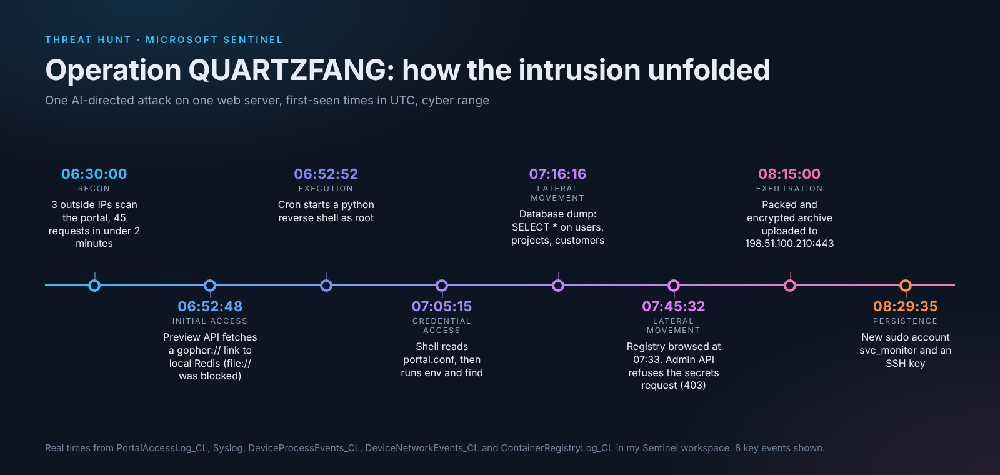

# Operation QUARTZFANG: Hunt 193 (Cyber Range)

**Hunter:** Virginia Gina Nelai  |  **Platform:** Microsoft Sentinel and Defender advanced hunting (KQL)  |  **Workspace:** LAW-HuntPractice  |  **Window:** 20 Sep 2026, 06:30 to 08:30 UTC  |  **Times:** UTC (the portal shows EDT)
**Result:** 2850/2850 points, 28/28 flags, finished on time, no paid hints.
This hunt was done in a cyber range, on a made-up company called SemiCrest Technologies.

## What happened

An alert fired on the company web portal (sc-portal01) at 06:52. The portal has a document preview feature that fetches a web address for you. An attacker used it to make the server talk to itself. The first try, a file:// address, was blocked. 18 seconds later a gopher:// address aimed at the Redis service on the same machine got through. Within a second, cron (the scheduler) started a python script as root. The script opened a connection back to the attacker's address, 203.0.113.87. That was a reverse shell.

From that shell the attacker read the portal's config file and found logins for the database and the container registry, and the address of the admin API. Over the next hour it dumped database tables, browsed the registry, and asked the admin API for secrets (the admin API said no). At 08:02 it packed what it had into an archive, encrypted it, and uploaded it to 198.51.100.210. At 08:29 it made a new admin account called svc_monitor and an SSH key, so it could come back.

Most of the work was done by an AI agent, with a person approving at a few points. The range shared the agent's own log, and parts of that log are not true. It claimed it stole Kubernetes secrets and database admin credentials from a container image. The telemetry says neither happened.

## Attack chain

| Time (UTC) | What happened | MITRE |
|---|---|---|
| 06:30:00 to 06:31:52 | 3 outside IPs scan the portal, 15 requests each (45 total), same list of paths, one IP after another | T1595 (reconnaissance) |
| 06:44:05 to 06:44:15 | 203.0.113.87 tests URL types on /api/v1/preview: http and https work, ftp, file and dict are rejected | T1190 |
| 06:52:30 | preview?url=file:///etc/passwd, rejected (400) | T1190 |
| 06:52:48 | preview?url=gopher://127.0.0.1:6379/..., accepted (200), 18 seconds later | T1190 |
| 06:52:49 to 06:52:55 | Cron runs a python socket one-liner as root, process starts, connects to 203.0.113.87:443 | T1059.006 |
| 07:05:15 to 07:05:27 | Root shell runs cat /etc/semicrest/portal.conf, then env, then find for .conf and .env files | T1552.001, T1083 |
| 07:16:11 to 07:16:25 | Root shell connects to the database host. portal_svc runs SELECT * on users, projects and customers, lists table names, reads pg_shadow | T1078 |
| 07:33:01 to 07:33:05 | Registry as ci-builder from the portal: login, list, pull manifest, inspect layer | T1083 |
| 07:45:18 to 07:45:32 | More targeted database reads. Admin API from the portal: services 200, topology 200, secrets 403 | T1078 |
| 08:02:05 to 08:02:13 | tar, gzip and openssl in the hidden folder /tmp/.portal-cache | T1560.001 |
| 08:15:00 | curl POST of the encrypted file to 198.51.100.210:443 | T1041 |
| 08:29:35 to 08:29:55 | useradd svc_monitor, added to sudo, .ssh folder made, SSH key generated | T1136.001 |

I checked every ATT&CK ID above on attack.mitre.org. The range gave T1190, T1059.006 and T1588.007 (Obtain Capabilities: Artificial Intelligence, the one for AI as the engine). I picked the others (T1595, T1552.001, T1078, T1560.001, T1041, T1136.001) as the best match for what I saw.

## How I proved it was malicious

- **The process does not belong.** The web app runs as gunicorn under www-data. A python script with a socket, started by cron as root, is not something the app spawns. The cron log line at 06:52:49 shows it too.
- **Two different jobs share a login.** The app's own database sessions carry application_name=portal_svc and run small, filtered queries. The attacker's sessions have no application_name and run SELECT * on whole tables, plus information_schema and pg_shadow, 1 to 3 seconds apart.
- **New behaviour for old accounts.** ci-builder normally only pulls and pushes images from the build server (10.5.0.100). From the portal it logged in, listed repositories, read a manifest and inspected a layer. portal_svc had never touched the admin API before 07:45.
- **Exfil stands out on port 443.** The portal makes normal HTTPS calls as www-data to four recurring addresses. The upload was root, to an address seen once, minutes after tar, gzip and openssl.

## How I checked the attacker's AI

The recovered log has 15 rows from the attacker's agent. The same table also holds 359 rows from SemiCrest's own assistant, which is a different thing and not part of the attack.

- **The pace is a machine.** Commands inside a burst are 1 to 6 seconds apart (cat, env and find are exactly 6 seconds apart). Between bursts there are quiet gaps of 11 to 17 minutes.
- **A person approved at 4 points.** The log shows an operator reviewing before credential work, before data collection, before staging, and before exfiltration. So it was a person who set a machine going.
- **Claim: it extracted Kubernetes secrets from the admin platform.** The admin API answered 403 to the secrets request, and it has no Kubernetes endpoint at all. Not true.
- **Claim: it found admin database credentials in a container image.** The registry shows four calls. The "inspect layer" call went to the vulnerability report address, not to the image contents, and no image data was downloaded. Not supported.

The lesson for a defender: treat an attacker's AI narration as a claim and check each one against the logs.

## What I ruled out

Three things looked like the attack and were not.

- **Same account (portal_svc).** The app really uses it. Revoking it would break the portal. Tell attacker from app by application_name and by what started the session. Kill the shell, then rotate the password.
- **Same tool (pg_dump).** A backup job runs as the backup account from a bash script on a schedule. It also ran at about 02:59 on 19 and 20 Sep, before the attack, so it is normal.
- **Same pattern (connection spike).** Around 07:30 the database logged about 365 errors ("too many clients already") from the portal host. Statements in that period stayed near normal, so it was the app running out of connections, not an attack. I checked statements against errors, because attacker queries also ran inside that window (07:43 and 07:45).

The external scanners and the internal Nessus scan are also different. Nessus (10.5.0.250) sent 19 slow requests over two hours. The outside IPs sent 15 each in about 30 seconds, using python-requests.

## What I could not see

- There is no Redis log and no file-write event for the cron job. The link "Redis wrote the cron job" is inferred from the gopher request, the cron line one second later, and the attacker log.
- Process logs show the command, not its output. I can say env ran, not what it printed, so I cannot say whether the environment held more credentials.
- There is no network log with bytes or URLs for the upload. I can show the connection and the curl command, not how much data left.
- Network telemetry exists on the portal only, not on the database, registry or admin hosts. The Postgres log has no session ID, so I grouped queries by time and content.
- Several tables repeat rows (2 times in some, 6 times in others). I removed exact duplicates before counting, so 45 outside-IP requests is 90 raw rows.

## Detections I would propose (not built or run)

These are ideas only. I did not deploy any of them.

- A preview request with a non-web scheme (gopher, file, dict) or a loopback target.
- A python child process of cron that opens an outbound connection.
- A Postgres session without application_name that runs SELECT * or reads pg_shadow.
- A tar, gzip and openssl chain in a hidden /tmp folder, then an upload to an address never seen before.
- useradd, sudo and ssh-keygen run by root on a web server.

## What I'd fix

- Block it at the source: the preview feature should only fetch web addresses, and never loopback or internal ones.
- Lock down Redis, and take root cron jobs off the web host.
- Rotate portal_svc and ci-builder, remove svc_monitor and its key, and remove the cron job.
- Alert on a first-seen outbound address from a root process.
- Least privilege: the web app's login could read the config file that held other services' logins.

## Indicators (defanged)

- Attacker source and reverse shell: 203[.]0[.]113[.]87:443
- Exfiltration: hxxps://198[.]51[.]100[.]210:443/upload
- Staging: /tmp/.portal-cache/report.tar.gz.enc
- New account: svc_monitor
- Outside scanners: 198[.]51[.]100[.]31, 198[.]51[.]100[.]45, 198[.]51[.]100[.]62

## Evidence

Screenshots are in [screenshots/](screenshots/). Key ones:
- [S1Q1](screenshots/S1Q1_preview_requests.png): the preview requests
- [S1Q4](screenshots/S1Q4_process_tree.png): cron starts the python shell
- [S2Q1](screenshots/S2Q1_config_read.png): config read, env, find
- [S3Q1Q2](screenshots/S3Q1Q2_db_burst.png): the database dump
- [S3Q4](screenshots/S3Q4_admin_api_403.png): admin API refuses secrets
- [S4Q2](screenshots/S4Q2_registry_enumeration.png): what the registry calls really were
- [S5](screenshots/S5_stage_exfil_persist.png): staging, upload, new account
- [S6](screenshots/S6_scanners_vs_nessus.png): outside scanners vs Nessus
- [S8Q3](screenshots/S8Q3_connection_spike_noise.png): the connection spike
- [S8Q2](screenshots/S8Q2_pg_dump_schedule.png): the nightly pg_dump backup on sc-db01 (portal_svc, application_name=pg_dump, about 02:59 UTC)

Three of the images below are tables I rendered from my exported query results (CSV, UTC), not portal screenshots. They put the key rows side by side:
- [S4Q1](screenshots/S4Q1_claim_vs_403.png): the AI's claim next to the admin API's 403
- [S7Q1](screenshots/S7Q1_operator_gates.png): the four operator approval gates
- [S8Q1](screenshots/S8Q1_application_name.png): application_name on the database sessions
