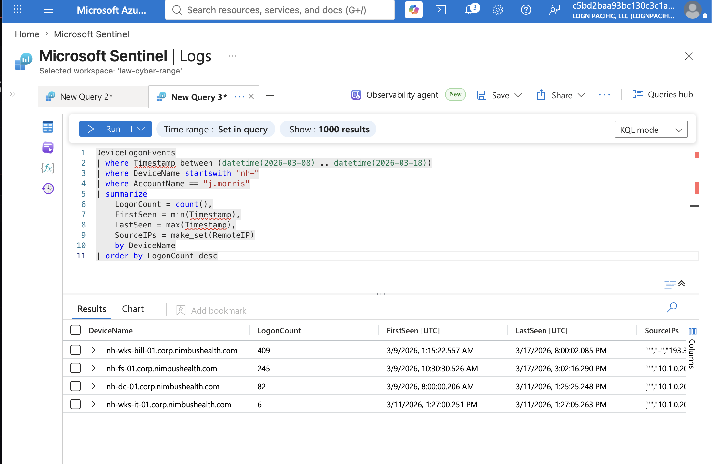
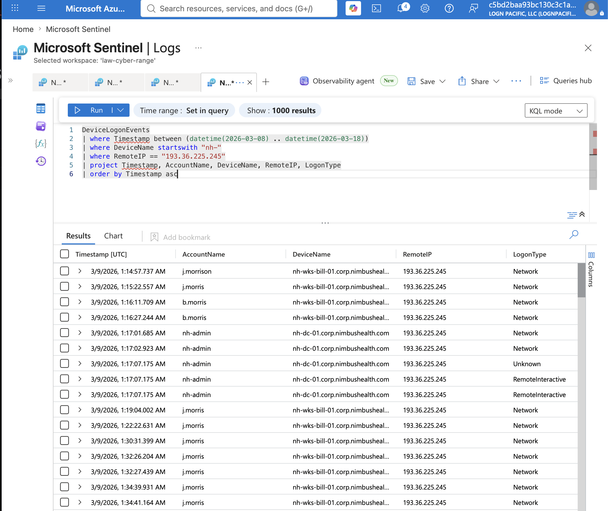
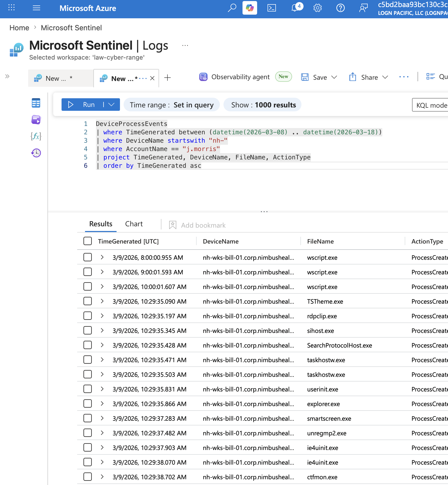
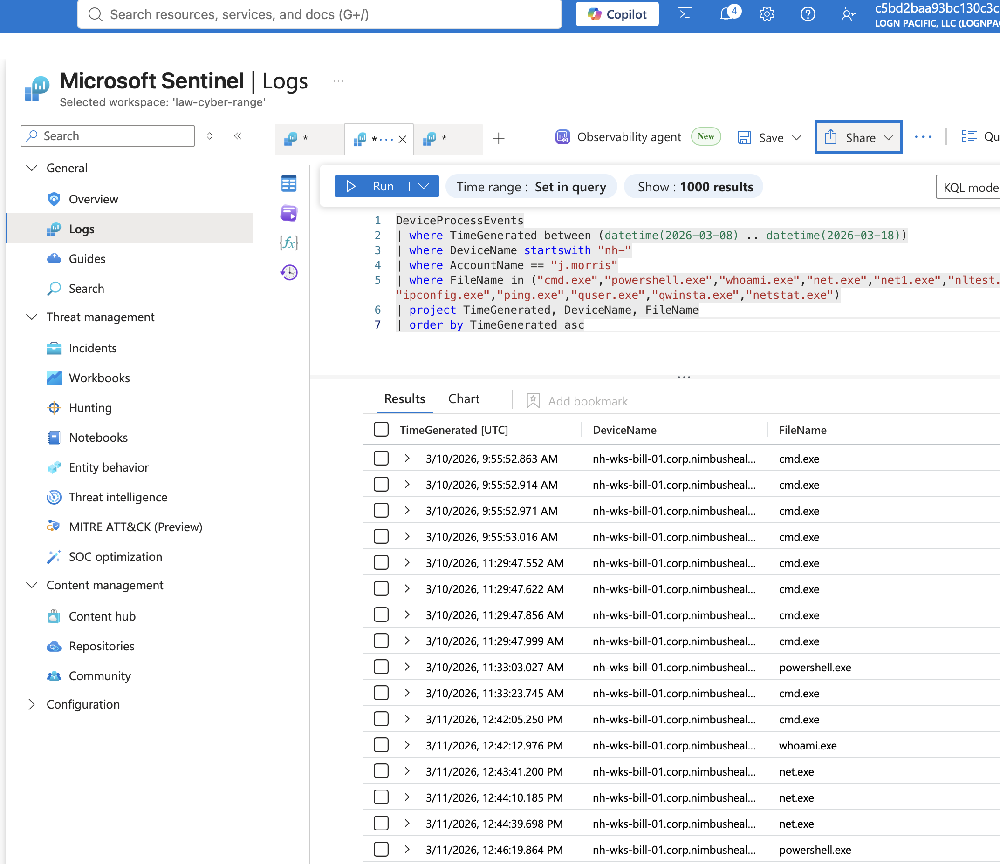
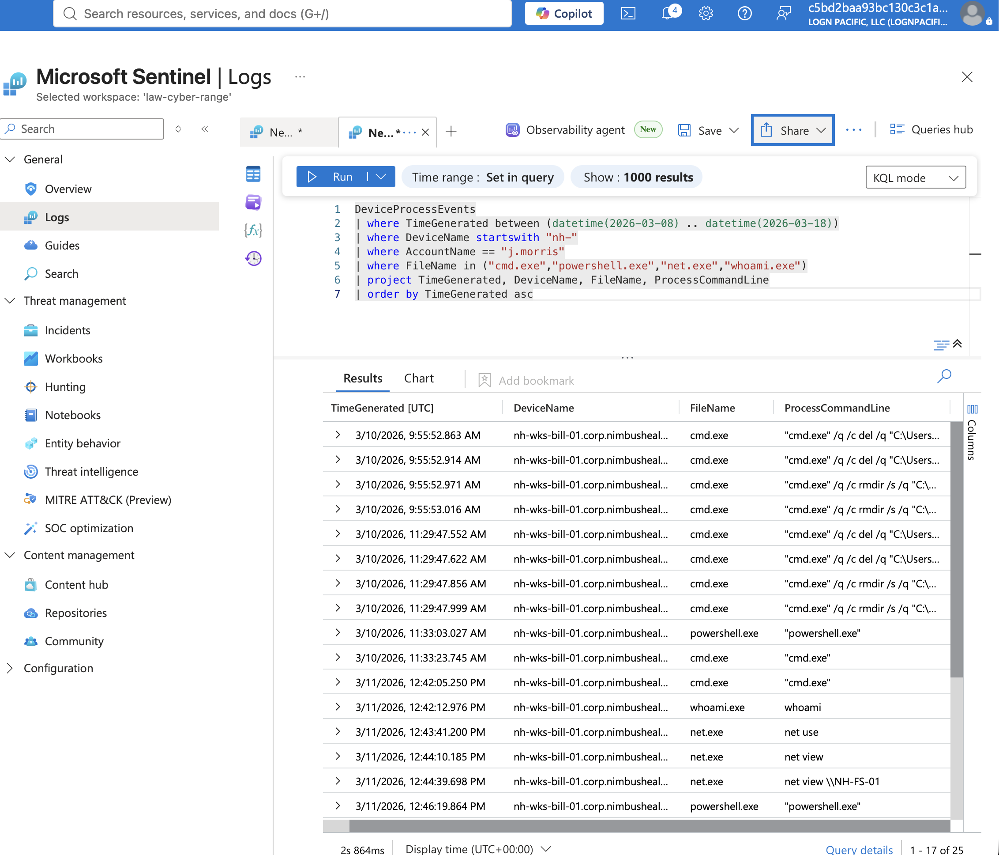
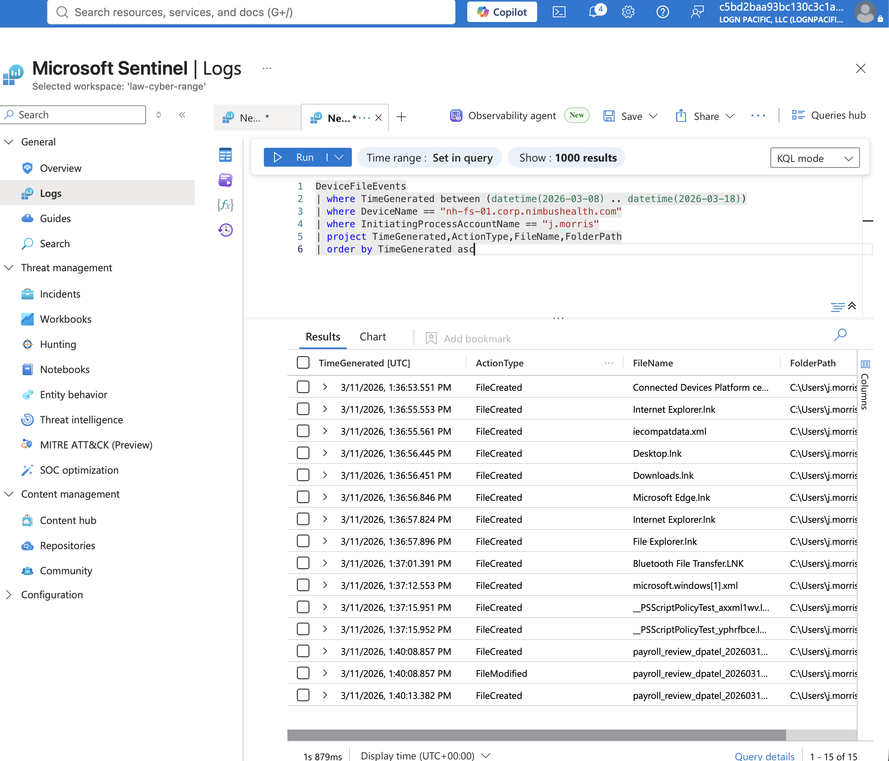
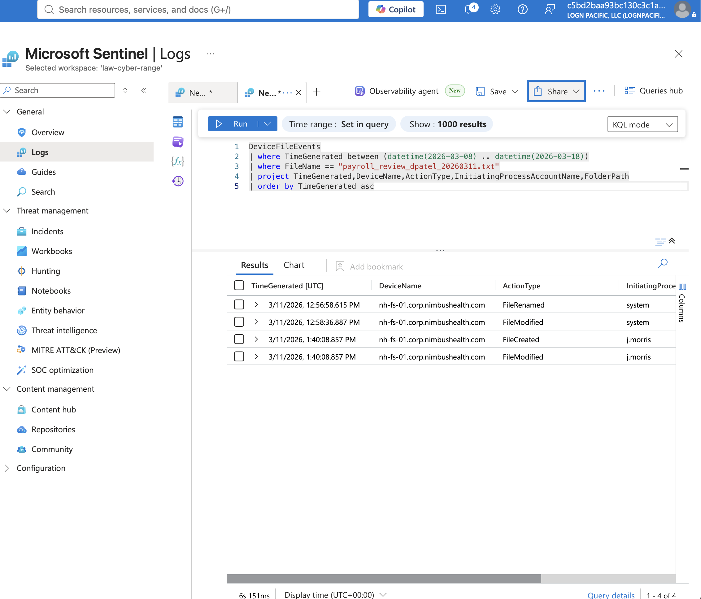

# Mission 01: Just Another Day, Valid Account Compromise at Nimbus Health
**Date:** 2026-07-12
**Tools:** Microsoft Sentinel, Microsoft Defender for Endpoint (MDE), KQL
**Track:** A (Cyber Hunt / SOC)
**Agent:** Vigil
**Platform:** LOG(N) Pacific Cyber Range
**Organization (scenario):** Nimbus Health
**Scenario type:** Valid Account Compromise / Cross-Department Collection
**Difficulty:** Beginner

## Objective

This was my first structured threat hunt. The objective was to investigate suspicious activity involving a billing analyst account and determine whether it was caused by an insider or a compromised account.

The hunt required correlating authentication, process, and file telemetry across multiple Microsoft Defender tables while separating legitimate Windows activity from attacker actions.

**Environment:** Microsoft Sentinel, Microsoft Defender for Endpoint (MDE), shared Sentinel workspace, Windows Enterprise environment.

**Tables used:** `DeviceLogonEvents`, `DeviceProcessEvents`, `DeviceFileEvents`, `DeviceEvents`

**Investigation flow:**
```
Authentication → Process Activity → Reconnaissance → Lateral Movement → File Collection → Root Cause Assessment
```

## Steps Taken

### Phase 0: Setup

Before investigating anything, I verified I was in the correct Sentinel workspace and scoped every query to:
- March 8-18, 2026
- Hosts beginning with `nh-*`

**Lesson learned:** always scope your investigation first. This was a shared workspace containing multiple incidents. Without proper filtering I would have investigated an entirely different attack.

### Phase 1: Authentication Investigation

Started with `DeviceLogonEvents` and asked: which account, where did it log in from, what logon type, and from what IP?

**Findings:**
- User: `j.morris`
- Logon type: `RemoteInteractive`
- Remote IP: `193.36.225.245`

A billing analyst remotely authenticating from a public IP immediately stood out as suspicious.

First, a summarized logon count by device for `j.morris` scoped to the environment. This is what showed the account's full footprint before drilling into any one machine: `nh-wks-bill-01` (409 logons, the billing workstation), `nh-fs-01` (245, the file server), `nh-dc-01` (82, the domain controller), and `nh-wks-it-01` (6, the IT workstation).



Raw query output: [query_data.csv](results/query_data.csv)

Then filtered `DeviceLogonEvents` down to the remote IP itself to see everything that authenticated from it.



### Phase 2: Process Investigation

Pivoted into `DeviceProcessEvents` to determine what the account actually did after authenticating.

Initial results were mostly Windows noise: OneDrive cleanup, Edge, Explorer, Windows startup, scheduled maintenance. This was my first lesson in separating background OS activity from actual attacker behavior.



### Reconnaissance

Once the noise was filtered out, the actual recon commands stood out:

```
whoami
hostname
net use
net view
net view \\NH-FS-01
```

Followed by:

```
net view /domain:nimbus
arp -a
nslookup
whoami /groups
net share
```

The attacker relied entirely on built-in Windows tools. No malware, no exploit, just Living-Off-The-Land (LOLBins).



Raw query output: [Evdidence.csv](results/Evdidence.csv)

Digging further into the process command lines turned up more than just look-around commands. A handful of `cmd.exe` entries were `del` and `rmdir` running against paths in the user's own folders, active cleanup, not reconnaissance. Between the discovery commands and the deletions, this confirmed the account wasn't just poking around, it was covering its tracks too.



Raw query output: [recon-evidence.csv](results/recon-evidence.csv)

### Phase 3: Lateral Movement

The attacker moved beyond the billing workstation:

```
Billing Workstation → File Server → IT Workstation
```

The IT workstation ended up being a red herring. The account authenticated there, but no meaningful activity followed.

**Lesson learned:** landing on a machine doesn't automatically mean attacker activity occurred there. Sometimes the absence of activity is evidence.

On the file server, the file events told the rest of the story. Right after `j.morris` landed on `nh-fs-01`, Windows created a fresh batch of default desktop shortcuts, Internet Explorer, Edge, Desktop, Downloads, File Explorer, the kind of setup that only happens the first time an account gets a full remote desktop session on a machine. That confirmed this was a real interactive login to the file server, not just a connection to a shared folder.



Raw query output: [file-server-query.csv](results/file-server-query.csv)

### Phase 4: Collection

Pivoted into `DeviceFileEvents` and found payroll files being copied into the user's Documents folder, for example `payroll_review_dpatel_20260311.txt`. Windows immediately created a matching Recent shortcut (`payroll_review_dpatel_20260311.lnk`), confirming the document was opened.



Raw query output: [payroll_review_dpatel_20260311.csv](results/payroll_review_dpatel_20260311.csv)

This query, scoped to just that filename, also shows the file was first touched by `system` (renamed/modified around 12:56-12:58 PM) before `j.morris` created/modified it directly at 1:40:08 PM, matching the timestamp of the shortcut-creation activity seen in the previous query.

Further investigation showed the attacker also accessed additional HR material beyond payroll.

### Phase 5: Final Assessment

The investigation showed: valid credentials, remote access, built-in Windows tools, HR data collection, no malware, no software exploitation.

**Conclusion:** this was not an insider accidentally retaining access. The evidence supports a **Valid Account Compromise** using legitimate credentials from an external source.

## Findings

- Compromised account `j.morris` (billing analyst) authenticated remotely from external public IP `193.36.225.245` via a `RemoteInteractive` logon.
- Post-authentication activity was 100% built-in Windows utilities (LOLBins), no malware or exploit tooling observed.
- Attacker performed network/host reconnaissance (`whoami`, `hostname`, `net view`, `arp -a`, `nslookup`, `whoami /groups`, `net share`), deleted files/folders in the user's own directories to cover tracks, then pivoted from the billing workstation to the file server via an interactive remote desktop session, and briefly to an IT workstation with no further activity.
- Attacker collected payroll and additional HR documents from the file server, copying them into the compromised user's Documents folder, evidenced by matching `.lnk` shortcut creation.
- Root cause: valid account compromise / cross-department data collection, not insider misuse.

## Skills Demonstrated

Microsoft Sentinel and Microsoft Defender for Endpoint (MDE) investigation, KQL query authoring across `DeviceLogonEvents`, `DeviceProcessEvents`, `DeviceFileEvents`, and `DeviceEvents`, workspace/time/host scoping in a shared environment, evidence-based pivoting between tables, distinguishing legitimate Windows telemetry from attacker activity, identifying Living-Off-The-Land (LOLBin) technique usage, lateral movement tracing, data collection/exfiltration evidence analysis, and root cause assessment (insider vs. compromised account).

## Lessons Learned

**Threat hunting is asking questions.** KQL is just the tool: the real investigation comes from asking "what question am I trying to answer next?"

**Evidence drives every pivot.** Don't jump tables randomly; follow the evidence.

**Windows generates a lot of noise.** Most events are legitimate OS behavior. Learning to ignore normal activity is just as important as identifying malicious activity.

**Living-Off-The-Land is real.** The attacker never needed malware: everything was done using built-in Windows utilities (`whoami`, `hostname`, `net`, `arp`, `nslookup`, PowerShell).

**Absence is evidence.** No malware, no exploit, no meaningful activity on the IT workstation: those findings were just as valuable as the events that were present.

**Scope first.** Always filter time, hosts, and environment before asking investigative questions.

**Verify before assuming.** Don't assume column names, timestamp fields, or schema: different tables use different fields (`Timestamp` vs. `TimeGenerated`). Check first.

**Biggest personal takeaway:** the biggest mistake I made wasn't technical, it was misunderstanding how the hunt platform worked. I thought I was searching for one final flag and ended up over-investigating. Once I realized each phase had its own individual question and flag, everything clicked. The real lesson from this hunt wasn't KQL: it was learning to think like an investigator instead of trying to solve the entire incident at once, answering one question at a time and letting the evidence dictate the next step.

## ATT&CK Mapping

| Tactic | Technique | ID | Evidence |
|---|---|---|---|
| Initial Access | Valid Accounts | T1078 | `j.morris` billing analyst credentials used from external public IP |
| Initial Access | External Remote Services | T1133 | `RemoteInteractive` logon from `193.36.225.245` (possible) |
| Discovery | System Information Discovery | T1082 | `whoami`, `hostname` |
| Discovery | System Network Configuration Discovery | T1016 | `arp -a`, `nslookup` |
| Discovery | System Network Connections Discovery | T1049 | `net use`, `net view` |
| Discovery | Remote System Discovery | T1018 | `net view /domain:nimbus` |
| Discovery | Permission Groups Discovery: Domain Groups | T1069.002 | `whoami /groups` |
| Discovery | Network Share Discovery | T1135 | `net view \\NH-FS-01`, `net share` |
| Defense Evasion | Indicator Removal: File Deletion | T1070.004 | `del /q` and `rmdir /s /q` run against user-path directories |
| Lateral Movement | Remote Services: Remote Desktop Protocol | T1021.001 | Interactive session to the file server, confirmed by first-logon desktop shortcut creation |
| Collection | Data from Network Shared Drive | T1039 | Payroll file pulled from file server |
| Collection | Data from Local System | T1005 | File opened locally, confirmed by `.lnk` shortcut creation in Documents |

*Technique IDs are Vigil's mapping of the investigation to standard MITRE ATT&CK naming.*
