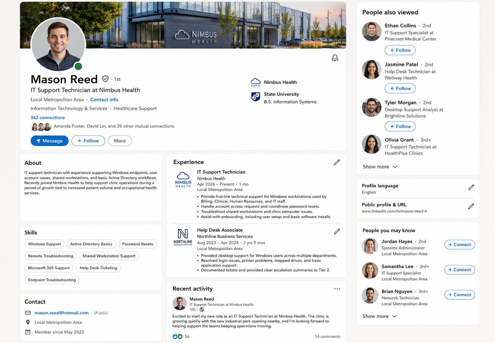
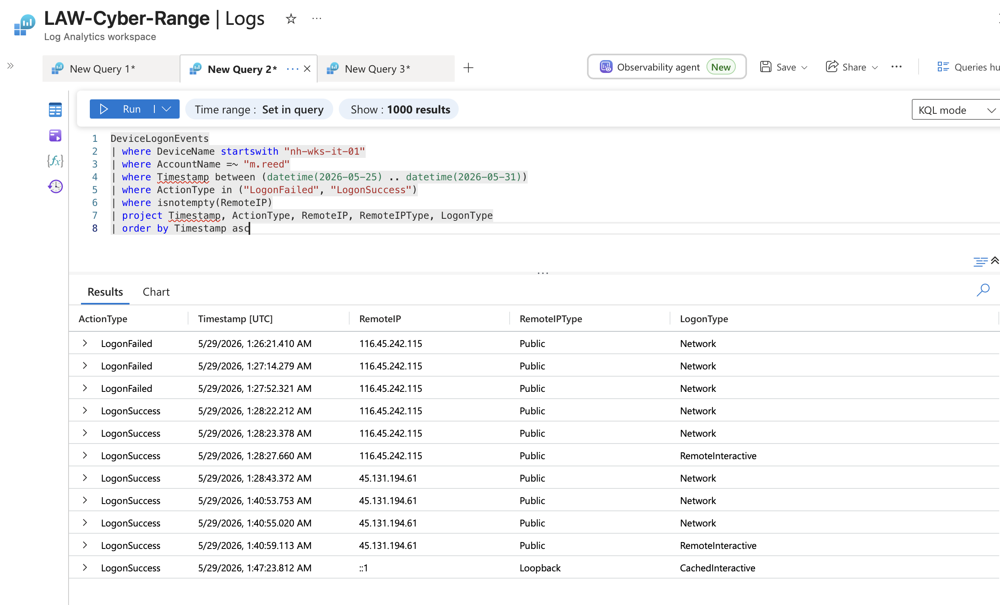
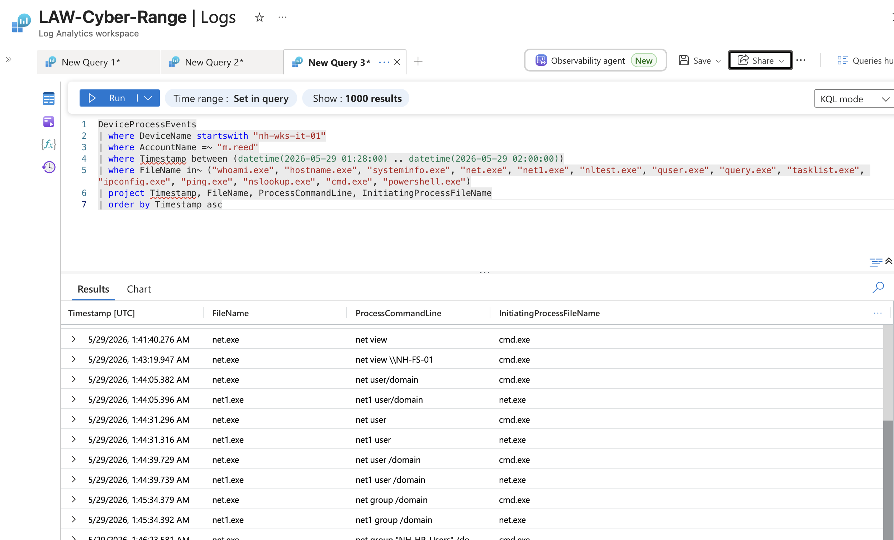
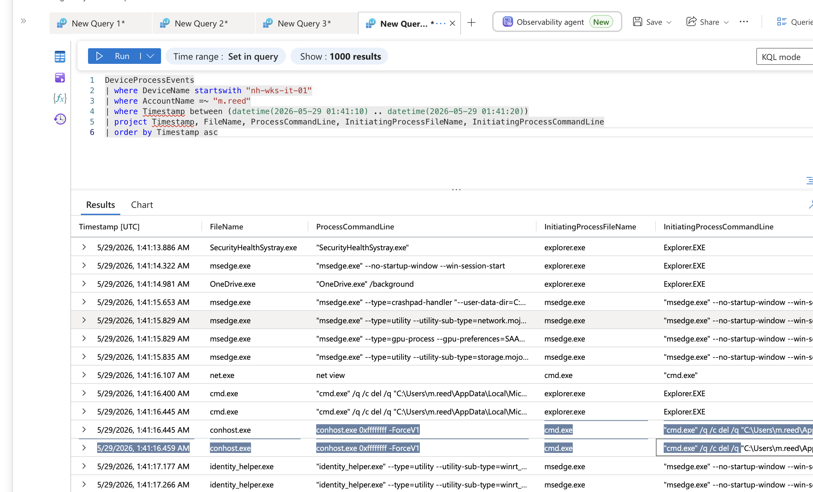
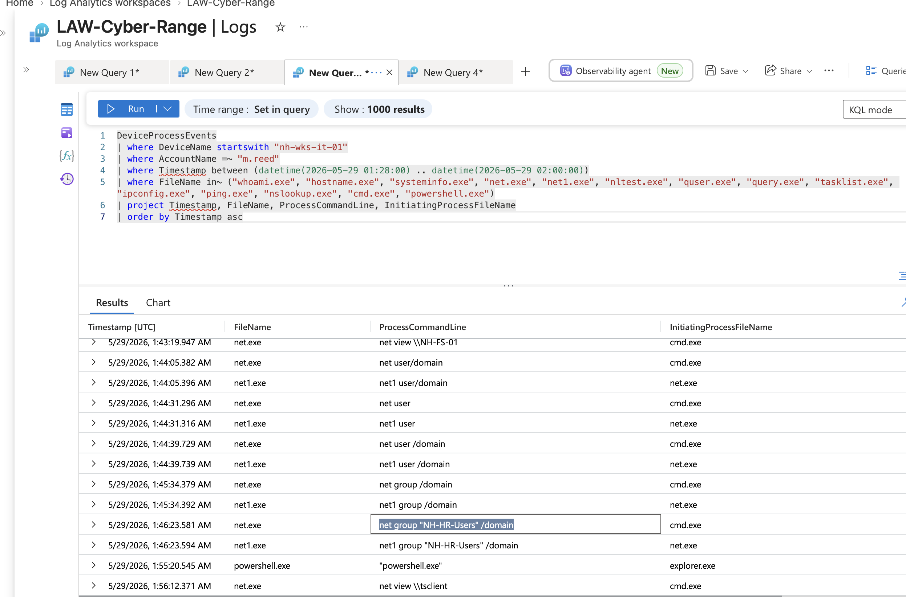
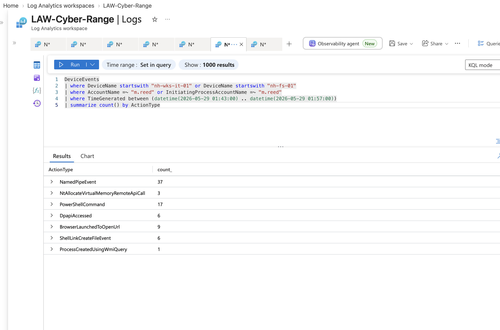
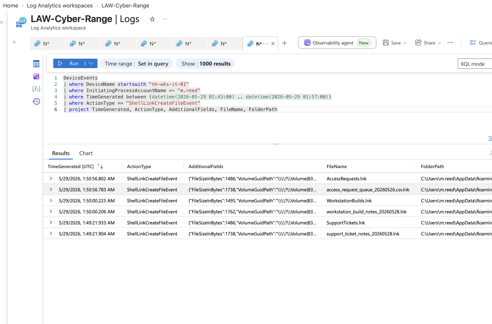
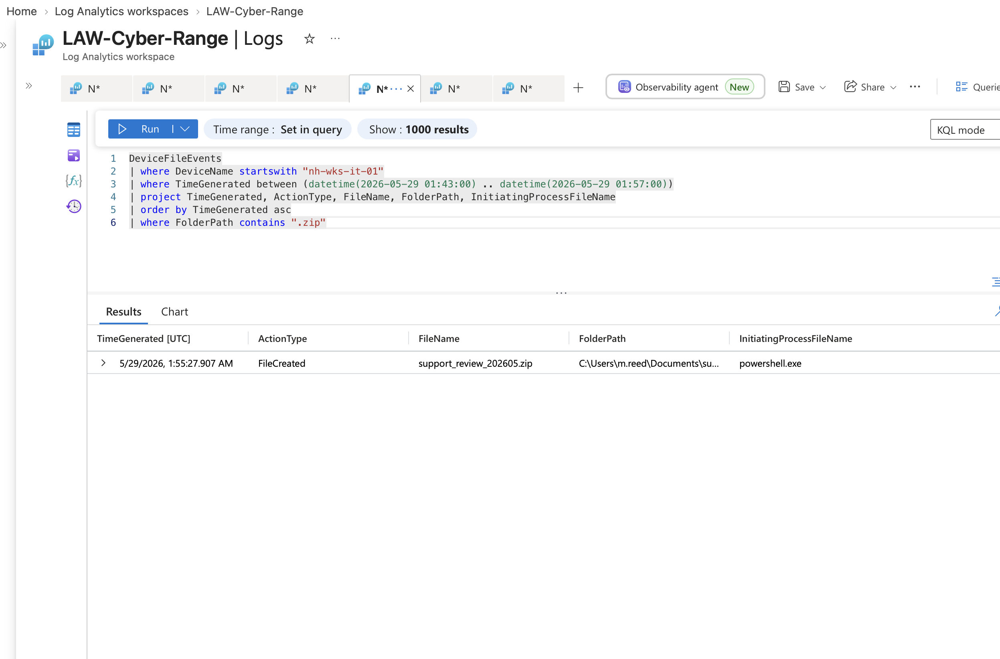
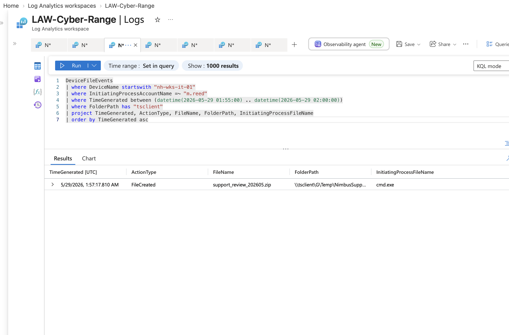

# Mission 03: Another Day, Part Two

**Case:** NH-INC-2026-0529 · Nimbus Health (scenario org — same client as Mission 01, "Just Another Day")
**Date:** 2026-08-17
**Tools:** Microsoft Sentinel (KQL), Microsoft Defender for Endpoint (MDE), OSINT artifact analysis
**Track:** A, Cyber Hunt / SOC
**Analyst:** Virginia Gina Nelai
**Platform:** LOG(N) Pacific Cyber Range
**Difficulty:** Beginner (harder edge than part one)
**Scope:** `nh-wks-it-01` — single host
**Window:** 25–30 May 2026

Nimbus Health grew fast this spring: a nearby industrial park opened, patient volume rose, and the clinic hired across every department at once, new starters dropped straight onto shared workstations, access review deferred until later. One of those new hires, an IT support technician one month into the job, had his identity and an old password sitting in public. This is the investigation into what happened once someone else found both.

Unlike Mission 01, this one didn't start in the SIEM at all. The first real answers were sitting in public, in what the internet already knew about the man whose account got used.

---

## Who they went after, and why

A public LinkedIn profile named the target directly: **Mason Reed**, IT Support Technician at Nimbus Health, one month into the role. His bio described exactly what made him worth targeting: he handled account access requests, coordinated password resets, and supported shared workstations across Billing, Clinical, HR, and IT, broad reach, low tenure, an easy account to justify going after. The profile also listed a personal contact address, `mason.reed@hotmail.com`, the bridge from a public post to a credential lookup.


*Mason Reed's public LinkedIn profile: one-month tenure, access-provisioning duties, and the personal Hotmail address that fed the next step.*

That email came back with three breaches on HaveIBeenPwned, and they weren't equally useful. A 2008 MySpace breach was old and hashed, an 18-year-old password nobody could still be running. A May 2024 Telegram combolist was more recent. But the one that mattered was **Synthient Credential Stuffing Threat Data, April 2025**: recent, plaintext, and close enough to the incident window that a reused password from it stood a real chance of still being valid. Age and format, not breach count, is what made this one the actual lead.

A fourth artifact closed the loop on *which* machine to point that password at: a cached internal support page, `nimbushealth.internal/it/support/remote-support-reference`, crawled and cached before Nimbus ever locked it down. The takedown didn't remove the cache. It named `NH-WKS-IT-01` as the approved remote-support endpoint, gave its public IP (`135.237.163.62`), and said outright to use domain credentials when logging in. Identity, a still-valid password, and a named target, all handed over before a single query ran.

---

## Getting in

Scoped to `nh-wks-it-01`, `m.reed`, and the May window, `DeviceLogonEvents` showed the box under constant brute-force noise, but almost none of it touched this account specifically: just 3 `LogonFailed` events out of 55 attempted and 89 successful logons total. That low count, against generic accounts getting hammered from dozens of sources, is what separated the real attempt from the noise floor.

Isolating the remote, IP-bearing logons told the actual story: three failed attempts from `116.45.242.115`, then two `Network`-type successes, then a `RemoteInteractive` session established at **1:28:27.660 AM on 5/29** — all inside about two minutes.


*The isolated remote-logon sequence: three failures, a pair of `Network` successes, then the `RemoteInteractive` session opening, all from `116.45.242.115`.*

That shape is the proof this was credential reuse, not brute force. A spray runs through hundreds or thousands of guesses over a long window from many sources. This was three attempts, two minutes, one address, matching an attacker who already held a specific password rather than one guessing blind, consistent with the Synthient breach data identified earlier.

Sixteen seconds after that first `RemoteInteractive` session opened, a second public IP, `45.131.194.61`, showed up with its own `Network`-type successes and zero failures of its own, already holding valid credentials. It opened its own `RemoteInteractive` session **12.5 minutes later, at 1:40:59.113 AM**, a clean session switch rather than the same operator idling: a new logon from a different address is exactly what explains the ten-minute gap between the first command burst and the second.

---

## First moves on the keyboard

The `RemoteInteractive` shell for the first session opened at 1:28:27 AM but the first typed command didn't land until **1:30:09 AM**, `cmd.exe` launched from `explorer.exe`, a session opening isn't the same as somebody starting work. From there the burst was short and generic:

```
whoami
hostname
ipconfig  /all
whoami  /groups
```


*The orientation burst, filtered directly to known recon binaries instead of paging through hundreds of Windows/Edge first-run noise rows.*

One thing sitting inside that same window turned out not to be the operator at all: two `del` commands against `OneDriveSetup.exe`, fired 46 milliseconds apart, 1.4 seconds after OneDrive's own `/background` auto-launch. Both were self-contained `cmd.exe /q /c` one-shots, initiated by `explorer.exe`, not by the operator's shell, which was busy running `net view` in a separate process lineage at the same moment. Timing proximity isn't causation: this was OneDrive cleaning up its own leftover installer files, a machine's own housekeeping, not a person's.


*The OneDriveSetup.exe deletion, process lineage showing it's a separate chain launched by `explorer.exe` alongside OneDrive's own startup, not the operator's shell.*

A second thing surfaced later, while chasing a different question, that looked worse than it was: a randomly-named folder and DLL (`f44kmtfh`, `f44kmtfh.dll`) compiled under `C:\Windows\SystemTemp\` around 1:49 AM, the classic signature of PowerShell compiling inline C# on the fly. Tracing the process chain showed `SenseIR.exe`, Microsoft Defender's own Live Response engine, launching a signed, execution-policy-locked script that compiled the DLL as part of its own diagnostic tooling. Not attacker activity, the EDR agent doing its job.

---

## Past the role

The second session, from `45.131.194.61`, ran a materially deeper enumeration than the first: file server discovery, domain user and group enumeration, and a group query aimed specifically at HR.

```
net  view
net  view \\NH-FS-01
net  user/domain
net  user
net  user /domain
net  group /domain
net  group "NH-HR-Users" /domain
```


*`net group "NH-HR-Users" /domain`, querying an HR-specific AD group by name — outside an IT Support Technician's entitlement per the role matrix.*

The role matrix (Artifact 04) pins `m.reed`'s access to the IT workstation and IT share only, Standard User, nothing broader. Querying an HR-named domain group is reach beyond that role by itself, but the stronger proof came from what got opened next. Summarizing `DeviceEvents` by `ActionType` in the enumeration window surfaced `ShellLinkCreateFileEvent`, the ".lnk" shortcut Windows creates every time a file is opened through Explorer, and its `ShellLinkWorkingDirectory` field records the file's real original path, something `DeviceFileEvents` alone never captured (it only logs create/modify/delete/rename, never a plain "open").


*`DeviceEvents` grouped by `ActionType` in the exfil window: `ShellLinkCreateFileEvent` is what led to the real network origin path.*

That path put one file squarely outside his role: `access_request_queue_20260526.csv`, opened from `\\Nh-fs-01\hr\2026-05\AccessRequests`, the HR share, not IT. An earlier guess, `employee_record_EMP-87291_20260527.txt`, looked like the more obvious HR file by name, but had no `.lnk` evidence tying it to any network origin at all; content can mislead, share ownership is the actual yardstick.


*`ShellLinkCreateFileEvent` rows for the session: `access_request_queue_20260526.csv.lnk`, working directory `\\Nh-fs-01\hr\2026-05\AccessRequests`, HR — out of role.*

Three files landed in a staging folder, `C:\Users\m.reed\Documents\SupportReview\`, inside a four-minute span: `access_request_queue_20260526.csv` (1:53:08 AM), `employee_record_EMP-87291_20260527.txt` (1:54:16 AM), and `access_review_notes_20260528.txt` (1:54:39 AM). The employee record is HR personal data by itself; gathering all three together in one folder is a staging pattern, not incidental browsing.

Notably, none of this ever touched the file server directly. A separate check of `nh-fs-01` found zero process executions under this account across the full window, only 39 `LogonSuccess` events, every one `Network`-type, the automatic SMB authentication handshake that fires the instant a share is opened, not an interactive session. The HR data was reached over the network from `m.reed`'s own workstation; he never ran anything on the file server itself, one machine compromised, not two.

---

## Taking it

The staged files were compressed via a single PowerShell cmdlet, `Compress-Archive -Path "C:\Users\m.reed\Documents\SupportReview\*" -DestinationPath "C:\Users\m.reed\Documents\support_review_202605.zip" -Force`, run in-session between 1:55:21 and 1:55:28 AM. Cmdlets like this never spawn a new process, so `DeviceProcessEvents` never saw it at all; only `DeviceEvents`' `PowerShellCommand` action, with the full command text in `AdditionalFields`, captured it.


*`support_review_202605.zip` created directly in `Documents`, one level above the `SupportReview` staging folder it was compressed from.*

Before it left, the operator checked the channel first: `net view \\tsclient` at **1:56:12.371 AM**, about a minute before the archive moved, the deliberate proof that this was premeditated exfiltration, not an opportunistic copy. `tsclient` is the standard Windows name for RDP's own client-drive redirection: when enabled, the operator's own local drives become reachable from inside the remote session at `\\tsclient\<drive>\...`. The copy-out step itself never spawned a process either, no command line, consistent with a GUI drag-and-drop inside the already-open RDP window. `DeviceFileEvents` caught the result directly: `support_review_202605.zip` written to `\\tsclient\G\Temp\NimbusSupport\support_review_202605.zip` at **1:57:17.810 AM**, initiated by `cmd.exe`.


*The archive landing at `\\tsclient\G\Temp\NimbusSupport\`, the RDP session's own redirected client drive, no upload, no cloud service, no outbound connection to catch.*

No file left the network in any way a perimeter control would flag. It walked out through a channel that was already open and already trusted, the session the operator was already sitting in.

---

## Judgement: what was left behind, and the honest root cause

Two closing questions were about absence, and the brief was explicit: prove a negative, don't assume it. Persistence was checked two independent ways across the full window, binary tools (`schtasks.exe`, `sc.exe`, `reg.exe`, `at.exe`) and the native PowerShell cmdlet equivalents (`New-Service`, `Set-Service`, scheduled-task cmdlets), both empty. The only scheduled-task activity near the exfil window traced to `svchost.exe -k netsvcs -p -s Schedule`, Windows' own Task Scheduler service running as SYSTEM, unrelated to `m.reed`'s session. No persistence mechanism was established.

Put together, the evidence reads as one thing: an external attacker driving `m.reed`'s account remotely over RDP, from two external IPs (`116.45.242.115`, then `45.131.194.61`), not Mason Reed himself and not a local insider. Nothing here points to malware, no malicious binary anywhere in the telemetry, no persistence, no C2 channel; every tool used, `net.exe`, native PowerShell cmdlets, RDP's own drive redirection, was legitimate Windows functionality used exactly as designed, pure living-off-the-land. And nothing here points to a genuine insider either: two unrelated external IPs fifteen minutes apart, a brute-force-then-succeed pattern against his own account, a credential traced to public breach exposure rather than something only he would know, and a sharp behavioral split between a light four-command orientation burst and a deep, deliberate reach for the HR share.

**Root cause:** valid account compromise via public credential exposure and OSINT reconnaissance, enabled by a leaked internal document that told the attacker exactly which host to target and confirmed domain credentials would work, not a malicious insider, not malware.

**First containment, and why a reset alone isn't enough.** The recommendation on this one wasn't to reset Mason's password and call it a curious new hire. It was to disable the `m.reed` account and isolate `nh-wks-it-01` immediately: a reset doesn't end a session that's already open, and it doesn't undo a compromise that's already happened. Containment has to cut access at the account and host level while the incident is investigated, prevention of future access and termination of current access are two different problems.

**Disclosure.** One of the staged files, `employee_record_EMP-87291_20260527.txt`, is employee personal data, not just internal business records. Its exfiltration isn't only a technical finding, it creates a data breach notification obligation: the affected individual, and potentially regulators, have to be told. That moves this from an internal IT cleanup into a legal and compliance matter before it ever gets written up as "just a curious new starter."

---

## How I found it

I worked outside the SIEM first, per the brief's own instruction, identity, then exposure, then the machine, before writing a single query. That order mattered: by the time I opened Sentinel, I already knew the account (`m.reed`), the likely breach source (Synthient, not the older MySpace hash), and the exact host and public IP an attacker would have been handed.

Inside Sentinel, the recurring discipline was three filters, not two: host (`startswith`, never `==`, this device is registered under its FQDN), date window, and account, bound together on every query. Skipping any one of them on a shared range pulled in either another tenant's scenario or someone else's noise.

Two field-level lessons cost real time before I caught them. `Timestamp` was unreliable on parts of this dataset while `TimeGenerated` was consistently populated, worth testing both rather than trusting one blindly. And `DeviceFileEvents` structurally only logs create, modify, delete, and rename, never a plain "open", so proving the HR file's real network origin required pivoting to `DeviceEvents`' `ShellLinkCreateFileEvent`, the one place Windows records where an opened file actually came from.

The biggest process lesson: once a `summarize count() by ActionType` reveals a promising action type, filter straight to it. Early on I paged through hundreds of rows by row-number batches, mostly Edge and Windows first-run noise, before switching to filtering directly on known recon binaries and relevant `ActionType` values, which is what actually cut through the volume.

And the two "prove the negative" questions were the clearest example of the brief's own warning: a quiet table isn't proof of nothing, it's data, but only once every mechanism that could produce the outcome has actually been checked, and every stray entry that does show up has been individually accounted for rather than dismissed on sight.

---

## MITRE ATT&CK coverage

| Tactic | Representative Techniques |
|---|---|
| Reconnaissance | T1589.001 (Gather Victim Identity Info: Credentials, via public breach data), T1593 (Search Open Websites/Domains, LinkedIn profile + cached internal doc) |
| Initial Access | T1078 (Valid Accounts, reused breach credential), T1133 (External Remote Services, internet-facing RDP) |
| Execution | T1059.003 (Windows Command Shell), T1059.001 (PowerShell) |
| Discovery | T1082 (System Information Discovery), T1016 (System Network Configuration Discovery), T1069.002 (Domain Groups), T1087.002 (Domain Account), T1135 (Network Share Discovery), T1018 (Remote System Discovery) |
| Lateral Movement | T1021.001 (Remote Desktop Protocol) |
| Collection | T1039 (Data from Network Shared Drive), T1074.001 (Local Data Staging) |
| Archive | T1560.001 (Archive via Utility, `Compress-Archive`) |
| Exfiltration | T1021.001 (RDP client-drive redirection used as the exfil channel) |
| Persistence | None found — proven negative, two independent checks (binary tools and native cmdlet equivalents) |

*Technique IDs are Gina's mapping of the investigation to standard MITRE ATT&CK naming.*

---

## Skills demonstrated

OSINT-driven reconnaissance reconstruction (public profile → breach exposure data → leaked internal document), Microsoft Sentinel and Defender for Endpoint (MDE) investigation, KQL query authoring across `DeviceLogonEvents`, `DeviceProcessEvents`, `DeviceFileEvents`, and `DeviceEvents`, credential-reuse-versus-brute-force analysis, distinguishing legitimate Windows/EDR housekeeping from operator activity via process lineage, identifying an RDP client-drive-redirection exfiltration channel, proving negatives (no persistence, single-host scope) through independent verification paths, reasoning through containment sequencing and data-breach disclosure triggers, and MITRE ATT&CK mapping.

## What I learned doing this

The account filter matters as much as the host and date filter on a shared range, missing it pulls in every other user's activity too, not just noise from other tenants. Failure count and time span, not just "were there failures before the success," are the actual signal that separates credential reuse from brute force: few attempts in a tight window from one source reads completely differently from a long, noisy spray. A gap in the command timeline isn't idle time by default, checking the logon table for a new session starting in that window explained it directly instead of assuming nothing happened. Not every deletion or compiled artifact is a cover-up, twice in this hunt something that looked like tampering turned out to be a machine (OneDrive, Microsoft's own EDR agent) doing its own job, and process lineage was what told the two apart. And a discovery command run immediately before the action it enables, `net view \\tsclient` a minute before the archive moved, is the actual evidence line between "happened to notice a channel" and "planned to use it," sequence and proximity carry as much weight as the command itself.

---

## Supporting evidence

- [Mason Reed's HaveIBeenPwned breach lookup](Evidence/mason_reed_haveibeenpwned.pdf) — the three breach exposures referenced above, and why the Synthient Credential Stuffing data was the one that mattered.
- [Nimbus Health Security Operations Artifacts, May 2026](Evidence/Nimbus_Health_Security_Operations_Artifacts_May.pdf) — the role/access matrix used to establish `m.reed`'s actual entitlements.
- [Hunt log](Evidence/hunt_log.md) — raw working notes from the investigation: every query tried, field-level lessons, and dead ends, in the order they happened.

---

*This is a simulated incident, conducted on the LOG(N) Pacific Cyber Range as part of a cybersecurity internship. All findings are based on telemetry and artifacts from the fictional Nimbus Health training estate.*
