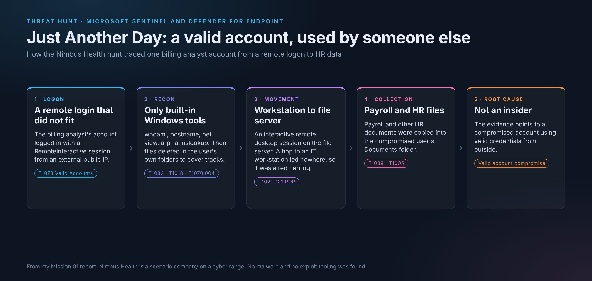
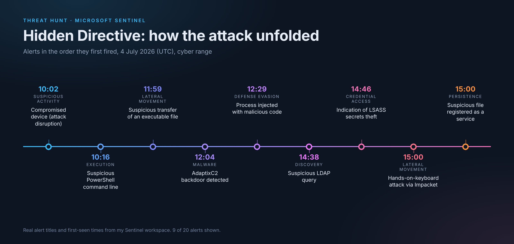
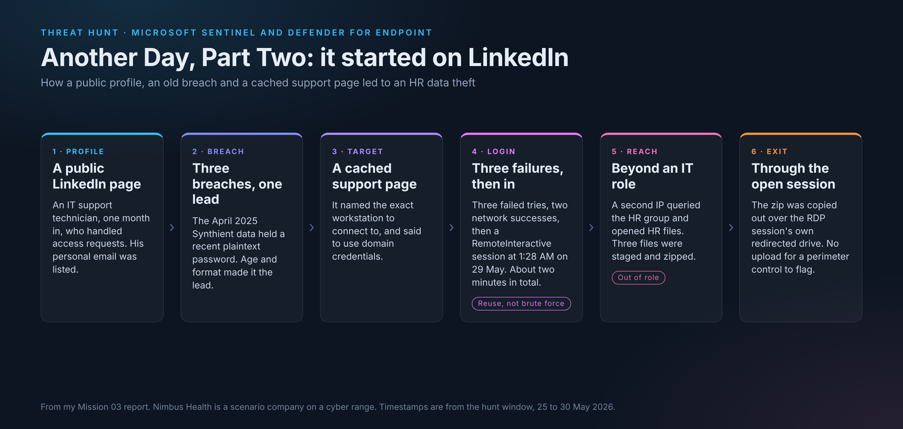

# Threat Hunting Labs

Hands-on threat hunting work in Microsoft Sentinel and Microsoft Defender for Endpoint (MDE), correlating authentication, process, and file telemetry to investigate suspicious activity and determine root cause. Each mission is a self-contained lab with its own report, screenshots, and raw query exports.

_Defensive security work by Virginia Gina Nelai, performed on the LOG(N) Pacific Cyber Range._

---

## Labs

**Mission 01: Just Another Day, Valid Account Compromise** ([report](Mission_01_Just_Another_Day/report.md))
Investigated suspicious remote access to a billing analyst account at Nimbus Health (scenario org). Pivoted across `DeviceLogonEvents`, `DeviceProcessEvents`, `DeviceFileEvents`, and `DeviceEvents` to trace authentication from an external public IP, LOLBin-based reconnaissance, lateral movement to a file server, and collection of payroll/HR documents. Root cause: valid account compromise, not insider misuse.

**Mission 02: Hidden Directive, AI Prompt Injection to Domain Compromise** ([report](Mission_02_Hidden_Directive/report.md) · [full incident report](Mission_02_Hidden_Directive/Report/GF-INC-2026-0704_Incident_Report.md))
Full DFIR investigation at Greenfield Logistics (scenario org) across three hosts. An internal AI page-summarizer read a booby-trapped web page and executed hidden instructions embedded in it, no human had to click anything. Traced the intrusion from that initial prompt injection through defense evasion, four separate persistence mechanisms, an LSASS memory-access credential theft, and lateral movement into the domain controller, correlating across Sentinel and Defender XDR with KQL. 20+ ATT&CK techniques mapped. Includes a Lessons Learned section from a follow-up debrief: what held up and what I'd correct.

**Mission 03: Another Day, Part Two, OSINT-Driven Credential Reuse** ([report](Mission_03_Another_Day_Part_Two/report.md))
Sequel investigation at Nimbus Health, this one starting outside the SIEM entirely. A new IT hire's identity and an old, still-valid password were sitting in public: a LinkedIn profile, a breach-exposure lookup, and a leaked internal support document that named the exact host to target. Traced the resulting RDP compromise from a low-volume, targeted brute-force success through HR-share enumeration outside the account's role, staging and compression of exfiltrated data, and an exfil channel hiding in the RDP session's own drive redirection, no upload, no outbound connection to catch. Closed with two proven negatives (no persistence, single-host scope) and reasoning through containment scope and breach-disclosure obligations.

**Hunt 191: Operation ECHOLEAK, AI Assistant Data Leak** ([report](Hunt_191_ECHOLEAK/report.md) · [summary](Hunt_191_ECHOLEAK/Executive_Summary.md))
Investigated how a Copilot assistant leaked company information in a cyber range hunt. An employee opened an outside email attachment and asked Copilot to summarise it. Hidden instructions in the document made Copilot search and read 13 files across Finance, Executive, HR and IT, then put 13 image links to an outside domain in its replies, so the file names left in ordinary web requests. Proved it was an attack by comparing against 34 normal sessions (tool use, pace, files never opened, outside links), ruled out a stolen account, and stated what the logs could not prove. Mapped to MITRE ATLAS and ATT&CK, with proposed detections and fixes.

---

## Skills Demonstrated

Microsoft Sentinel and Microsoft Defender for Endpoint (MDE) investigation, KQL query authoring, cross-table evidence correlation, workspace/time/host scoping, Living-Off-The-Land (LOLBin) technique identification, lateral movement tracing, data collection analysis, MITRE ATT&CK mapping, root cause assessment, static malware/artifact analysis, AI prompt-injection attack analysis, AI assistant data-leak investigation, OSINT-driven reconnaissance reconstruction, containment-scope and breach-disclosure reasoning.

## About
Part of my cybersecurity portfolio. More: [github.com/vnelai](https://github.com/vnelai)
